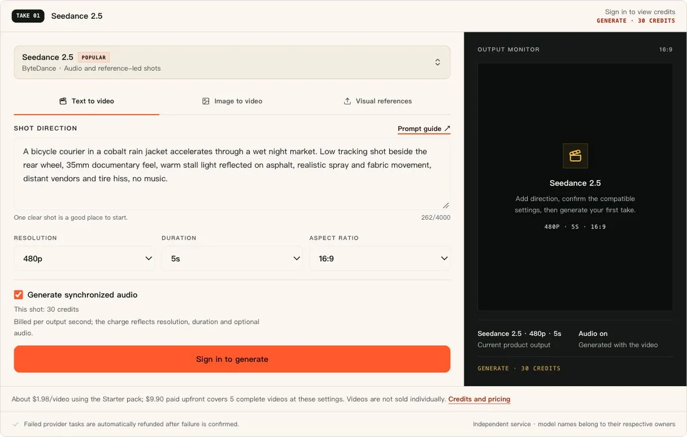
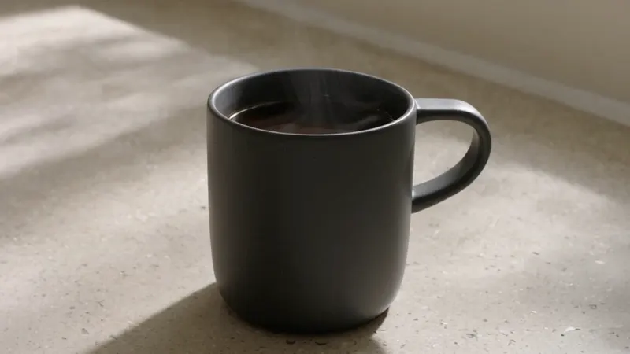

# SeedanceAI.dev — AI Video Workspace

Turn a shot idea into an AI video, with prompts, image guidance and generation settings you can inspect before starting.

**[Open the video workspace](https://seedanceai.dev/?utm_source=github&utm_medium=referral&utm_campaign=public_showcase)** · [Browse real examples](examples/README.md) · [Check Mini trial eligibility](https://seedanceai.dev/seedance-2-0-free?utm_source=github&utm_medium=referral&utm_campaign=public_showcase)

SeedanceAI.dev is an independent hosted service. It is not affiliated with or endorsed by ByteDance. Model names belong to their respective owners.

This public repository contains original prompt examples, workflow notes and media from the site. The application source code is maintained privately.

## Real outputs, with their inputs

These are existing, unedited site outputs. Each example includes its exact prompt, requested settings, original video, file hash and a specific limitation. A good-looking sample does not establish a model's overall success rate.

| Example | Input | Requested settings | Inspect the result |
| --- | --- | --- | --- |
| [Espresso cup: steam and a slow push-in](examples/espresso-cup.md) | Text prompt | Seedance 2.5 · 480p · 5 seconds · 16:9 · audio | [Original MP4](assets/espresso-cup/output.mp4) |
| [Zombie reunion: an embrace, then a memory](examples/zombie-reunion.md) | Text prompt + two fictional adult portraits | Seedance 2.5 · 480p · 10 seconds · 9:16 · audio | [Original MP4](assets/zombie-reunion/output.mp4) |

### Espresso cup

A short product shot to inspect steam, camera movement and composition. [Read the prompt and settings](examples/espresso-cup.md).

### Zombie reunion

Two reference portraits and two requested shots. The accepted output is take 2 of two submissions; the man turns away after the cut, so his facial continuity in the second shot remains unverified. [Inspect the full case](examples/zombie-reunion.md).

## Try a prompt

1. Copy the exact prompt from an example.
2. [Open the workspace](https://seedanceai.dev/ai-video-generator?utm_source=github&utm_medium=referral&utm_campaign=public_showcase), choose a compatible model and check the scene, resolution, duration and audio settings.
3. For image-guided work, use reference images you have the right to upload. Keep the reference order shown in the example.
4. Review the displayed credit quote before generating. Compare the complete result with your intended shot; repeat generations can differ.

## Access and pricing

You can inspect the prompts and samples here without creating an account. Generating through the hosted service requires an account and sufficient credits.

The examples above use Seedance 2.5. They are separate from the Mini trial workflow. [Check current trial eligibility](https://seedanceai.dev/seedance-2-0-free?utm_source=github&utm_medium=referral&utm_campaign=public_showcase) and [current pricing](https://seedanceai.dev/pricing?utm_source=github&utm_medium=referral&utm_campaign=public_showcase) on the website before starting.

## More resources

- [Seedance prompt guide](https://seedanceai.dev/seedance-2-5-prompt-guide?utm_source=github&utm_medium=referral&utm_campaign=public_showcase)
- [Complete zombie reunion case and limitations](https://seedanceai.dev/zombie-love-story-ai?utm_source=github&utm_medium=referral&utm_campaign=public_showcase)
- [Machine-readable example manifest](examples/manifest.json)

## Feedback and permissions

[Open an issue](https://github.com/maomaotocome/SeedanceAi/issues) for feedback about these examples or the hosted service. See [CONTRIBUTING.md](CONTRIBUTING.md) for what to include and how to keep reports free of private information.

Prompt reuse and media permissions are described in [CONTENT-LICENSE.md](CONTENT-LICENSE.md). This showcase does not grant a license to the private application source or any third-party model, template or trademark.
